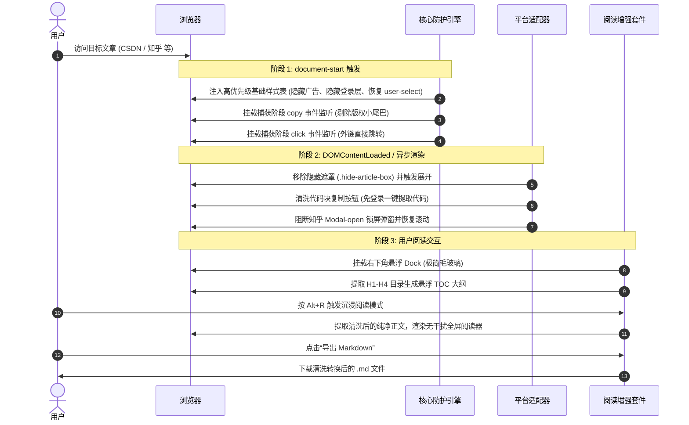

# 纯净阅读 (PureReader) — 全网通用沉浸阅读、排版净化与元素橡皮擦

为 **CSDN、知乎、掘金、简书、博客园、微信公众号** 提供深度免登录去广告与宽屏排版净化，同时内置 **全网兜底通用阅读模式 (Universal Fallback)** 与 **可视化元素橡皮擦 (Element Zapper)**，可在任意个人博客、Substack、Medium、新闻站点中自动识别正文并按域名持久屏蔽干扰元素。

核心提供：智能正文提取、悬浮大纲目录 (TOC)、4 种护眼主题沉浸阅读模式 (Zen Mode)、一键导出 Markdown / PDF，以及在未知网页零侵入运行的按需唤醒体验。

---

## 整体架构设计

脚本遵循自包含单文件 IIFE 架构，无外部构建依赖，在 `document-start` 阶段前置切入渲染流程，保障零样式闪烁（Zero FOUC）。

```mermaid
flowchart TB
    subgraph Browser["浏览器运行环境 (Chrome / Edge / Safari / Firefox)"]
        subgraph TM["Tampermonkey 沙箱环境 (pure-reader.user.js v0.1.0)"]
            direction TB
            
            subgraph CoreEngine["底层核心防护与存储引擎 (document-start)"]
                CSS_INJECT["动态样式注入器 (safeAddStyle & 域名橡皮擦规则前置注入)"]
                COPY_GUARD["剪贴板防劫持与复制解禁器 (已知平台清洗 / 未知站点零误伤)"]
                LINK_GUARD["外链直达跳转器 (URL Rewrite & Click Capture)"]
                CONFIG_MGR["配置与按域名规则存储 (pureReaderConfig & pureReaderZapperRules)"]
            end

            subgraph ExtractionLayer["正文识别与适配器矩阵"]
                KNOWN_ADP["6大中文平台深度适配器<br>(CSDN / 知乎 / 掘金 / 简书 / 博客园 / 公众号)"]
                UNIV_EXT["全网兜底正文识别引擎 (UniversalExtractor)<br>(CJK+英文加权 / 标点密度 / 多章节聚合)"]
            end

            subgraph ReadingSuite["高级阅读与净化套件"]
                ZAPPER["可视化元素橡皮擦 (ElementZapper)<br>(悬停高亮 / ↑↓层级微调 / 实时撤销)"]
                TOC_CTRL["智能悬浮大纲控制器 (Floating TOC)"]
                ZEN_MODE["沉浸极简阅读器 (对比度安全修复 & src/picture 恢复)"]
                EXPORTER["知识导出引擎 (Markdown 绝对路径补全 / Print PDF)"]
                DOCK_UI["Anthropic 设计风悬浮工具坞 & 设置面板"]
            end

            CoreEngine --> ExtractionLayer
            ExtractionLayer --> ReadingSuite
        end

        subgraph TargetPages["宿主目标站点"]
            P_KNOWN["CSDN / 知乎 / 掘金 / 简书 / 博客园 / 公众号"]
            P_UNIV["任意博客 / Substack / Medium / 新闻与文档站 (http/https)"]
        end

        ReadingSuite -.-> TargetPages
    end
```

---

## 核心时序图：拦截与净化流程

---

## 平台适配矩阵

| 目标平台 | 匹配域名 | 核心适配特性 |
|---|---|---|
| **CSDN** | `*://*.csdn.net/*` | • **宽屏大视野自适应加宽**：正文主区域拓宽至 `1200px`，彻底解决长代码横向挤压与阅读局促感 • **彻底根治强制跳转登录页**：清除 `.btn-readmore.click()` 陷阱与多层付费遮罩，前置桩化 `window.csdn.loginBox` 与 `userLogin`，拦截强制跳转 `passport.csdn.net` • 自动展开全文，移除“关注博主阅读全文”与 VIP 付费墙遮罩 (`.simple-vip-paywall, .vip-mask`) • 净化并移除固定在顶部的吸顶导航栏 (`#csdn-toolbar`) 与会员礼包入口 • 拦截未登录登录弹窗 (`passport-login-container`) 与全局锁屏 • 代码块免登录一键复制，彻底拦截“用码道免费领 Token / AI写代码”等代码块营销广告与展开遮罩 • 移除右侧侧边栏、底部博文推荐、悬浮工具栏、各类商业广告 |
| **知乎** | `*://*.zhihu.com/*` | • **宽屏大视野排版 (1060px)**：突破知乎专栏 `.Post-NormalMain`、`.Post-content` 原生硬编码 `690px` 锁死上限，突破知乎问答 `.Question-main`、`.Topstory-container` 原生 `1000px` 宽度夹持，主栏与版芯全面加宽至 `1060px` 居中舒适排布 • 拦截未登录滚动时触发的强制登录全屏弹窗 (`Modal-open`) 并恢复正常滚动 • 净化问答页吸顶导航栏 (`.AppHeader`)，享受纯净无干扰视野 • 自动展开折叠的回答与专栏文章 • 屏蔽知乎盐选专栏、知乎热榜侧边栏、商业推广卡片 |
| **掘金** | `*://juejin.cn/*` | • **大视野排版 (1050px)**：突破主栏 `.main-area.article-area` 锁死的 `width: 820px` 与外层 `.view.column-view` 的 Flex 约束，注入 `flex: 1 1 auto` 并拓展至 `1050px`，父容器扩至 `1120px` 居中对齐 • 隐藏顶部吸顶导航栏 (`header.main-header`) 与右下角悬浮面板 (`.suspension-panel`) • 严格样式隔离与盒模型重置，杜绝宿主 button CSS 污染导致控件变形与错位 • 移除右侧推荐栏、下载掘金 APP 悬浮窗、底部登录横条 |
| **简书** | `*://*.jianshu.com/*` | • **排版加宽 (1000px)**：精准穿透定位核心文章容器 `article._2rhmJa` 及多层父容器 `div._3VRLsv, div._gp-ck, section.ouvJEz`，彻底粉碎 `730px` 狭窄排版上限，自适应展开至 `1000px` • 隐藏顶部导航栏 (`nav.navbar`)，重置正文顶部间距 • 自动展开折叠文章 • 拦截底部“打开 APP 查看全部”引导横条与广告 |
| **博客园** | `*://*.cnblogs.com/*` | • **宽屏舒适视野 (1140px)**：突破 Flex 容器 `#main` 的原生 `flex-basis: 880px` 挤压，重置为 `flex: 1 1 auto`，隐藏侧边栏并将 `#mainContent` 释放拓宽至 `1140px` • 移除官方吸顶顶部栏 (`#top_nav`) 与博主自定义大头图横幅 (`#header`/`#blogHeader`) • 移除顶部、侧边及正文下方的全部广告位（c1/c2/b1/b2/ad_t2 等） • 隐藏冗余侧边组件，聚焦博客正文 |
| **微信公众号** | `*://mp.weixin.qq.com/*` | • **桌面端加宽 (980px)**：强制重写官方桌面端内嵌的 `.rich_media_area_primary { max-width: 677px !important }` 锁死上限，连带放开 `.rich_media_area_primary_inner` 与 `#img-content` 至 `980px` • 移除桌面端文章侧边扫码登录提示二维码与多余导流组件 • 解除文本长按与拖拽选中限制，提升宽屏阅读舒适度 |
| **全网通用兜底** | `http://*/*` `https://*/*` | • **轻量启发式正文识别 (`UniversalExtractor`)**：基于 CJK+英文加权长度、标点密度、语义标签与链接密度自动定位博客/Substack/Medium/新闻正文，兼容多 `<section>` 文章聚合，不侵入首页卡片流与后台 Web 应用 • **按需浮窗展示 (`universalDockMode`)**：默认仅在识别到长文时显示右下角工具坞 (`auto`)，非文章页仍可通过快捷键或油猴菜单唤起 • **可视化元素橡皮擦 (`ElementZapper`)**：任意网页悬停点击即可隐藏干扰元素，按域名在 `document-start` 自动屏蔽 |

---

## 高级阅读套件特性

### 1. 沉浸式极简阅读模式 (Zen Mode)
- **全局快捷键**：`Alt + R`（或点击悬浮 Dock 首个图标）随时开启/退出。
- **4 种精选调色板**：
  - **暖色羊皮纸 (Warm Canvas)**：底色 `#fbf9f4`，文字 `#2d2b28`，降低高光刺激，适合长时间长文阅读。
  - **清新护眼绿 (Eye-Care)**：底色 `#edf5ec`，文字 `#243324`，柔和舒适。
  - **纯白极简 (Clean White)**：底色 `#ffffff`，文字 `#1a1a1a`，对标电子墨水屏。
  - **深邃夜间黑 (Dark Night)**：底色 `#161615`，文字 `#dcdad5`，夜间深色不刺眼。
- **跨站点适配增强**：对暗色宿主站点补充浅色主题高对比度文字与表格覆盖规则，并自动恢复 `<picture>` `srcset` 与 `data-src` 懒加载图片、剥离评论区/订阅框/推荐阅读/已擦除元素。
- **排版微调**：支持 `A-` / `A+` 实时字号缩放（14px - 26px）、版芯宽度调节（860px / 1000px / 1180px 循环切换，默认 1000px 大版芯）。

### 2. 悬浮智能大纲 (Floating TOC)
- **全局快捷键**：`Alt + T`（或点击悬浮 Dock 第二个图标）快速展开/折叠。
- **层级感知**：自动解析文章内部 `H1-H4` 标题（自动过滤订阅表单、推荐框、评论区及橡皮擦隐藏区域内标题），构建阶梯缩进目录树。
- **实时跟踪**：监听页面滚动位置，自动高亮当前阅读小节，点击平滑平移至目标锚点。

### 3. 本地知识归档导出
- **导出 Markdown**：内建轻量 AST 节点转换器，将标题、段落、粗体、斜体、列表、引用块、表格、图片以及**带语法高亮标签的代码块**标准化输出为 `.md` 文件，并自动补全外链与图片相对路径为绝对 URL。
- **打印 / 导出 PDF**：自动挂载 `@media print` 净化样式，屏蔽网页无用按钮与背景噪点，一键唤起系统打印对话框存为矢量 PDF。

### 4. 剪贴板净化与外链直达
- **版权小尾巴清洗**：在已知技术平台彻底屏蔽类似 `“作者：xxx 链接：https://... 来源：知乎 著作权归作者所有...”` 以及 CSDN 的版权说明后缀；在未知站点保持克制，不破坏富文本应用编辑器行为。
- **外链中转绕过**：直接跳过 `link.zhihu.com`、`link.csdn.net`、`link.juejin.cn` 等平台的中转跳转确认页，直达目标站点。

### 5. 全网兜底通用阅读模式 (Universal Fallback)
- **轻量本地启发式引擎 (`UniversalExtractor`)**：综合评估 `
` 数量、CJK+拉丁字符加权字数、标点密度、正反向 class/id 权重（如 `article`/`prose` vs `sidebar`/`newsletter`/`comments`）及链接密度，并将同一 `<article>` 下分散的多 `<section>` 正文统一合并。
- **严谨双阈值门控**：自动展示悬浮坞时使用严格阈值（`finalScore >= 22`、`totalWeightedText >= 450`、段落数与低链接密度校验且过滤多篇卡片聚合页），确保首页列表/管理后台干净清爽；手动按 `Alt + R` 或菜单触发时放宽阈值并兜底语义标签，强制切入沉浸阅读、TOC 与导出流程。
- **灵活域名显隐控制**：支持在设置面板切换“智能检测 (`auto`) / 全部网页显示 (`always`) / 仅快捷键与菜单 (`manual`)”，或将当前域名加入 `ignoredDockDomains`。

### 6. 可视化元素橡皮擦 (Element Zapper)
- **交互选区与层级微调**：按 `Alt + Z`、点击工具坞橡皮擦图标或设置面板按钮进入擦除模式，实时高亮悬停节点并预览精准 CSS 选择器；支持键盘 <kbd>↑</kbd> / <kbd>↓</kbd> 或 HUD 按钮逐级扩大至父元素/缩小至子元素。
- **即时隐藏与撤销**：左键点击立即生成精简且唯一的 CSS 选择器（优先 `id`、语义属性、`class` 组合及结构路径），持久化写入当前域名规则表 `pureReaderZapperRules` 并实时生效；支持 HUD“↶ 撤销”或 <kbd>Ctrl</kbd>/<kbd>Cmd</kbd> + <kbd>Z</kbd> 即时撤回最近一条隐藏规则。
- **零闪烁回放与规则管理**：后续再次打开同一域名时，脚本于 `document-start` 阶段通过 `applyZapperCSS()` 前置注入屏蔽规则（Zero FOUC），且不误伤脚本自身 UI；设置面板内提供当前域名规则清单，支持单条“恢复”实时重现或一键清空。

---

## 数据模型与配置清单

所有配置均由 `GM_getValue` / `GM_setValue` 引擎在沙箱内持久化保存（核心配置键为 `pureReaderConfig`，橡皮擦规则键为 `pureReaderZapperRules`）：

| 配置键名 (`Key`) | 类型 | 默认值 | 功能释义 |
|---|:---:|:---:|---|
| `unblockCopy` | `boolean` | `true` | 解除防复制限制与自动清洗版权小尾巴 |
| `bypassRedirect` | `boolean` | `true` | 外链直接跳转（绕过中转页） |
| `removeAds` | `boolean` | `true` | 拦截广告、营销横幅与浮动挂件 |
| `autoExpandContent` | `boolean` | `true` | 自动展开全文/阅读全文 |
| `blockLoginModal` | `boolean` | `true` | 拦截未登录阻断弹窗与强制锁屏 |
| `enableFloatingTOC` | `boolean` | `true` | 启用智能悬浮文章大纲目录 |
| `enableZenMode` | `boolean` | `true` | 启用沉浸式极简阅读器 |
| `enableCodeCopy` | `boolean` | `true` | 代码块免登录一键复制增强 |
| `hideTopNav` | `boolean` | `true` | 净化/隐藏各平台顶部导航栏与大头图横幅 (CSDN/掘金/博客园/简书等) |
| `wideArticleLayout` | `boolean` | `true` | **宽屏大视野排版**：将各平台正文及版芯自适应拓宽至 1000~1200px |
| `enableUniversalFallback` | `boolean` | `true` | 在未知域名启用全网兜底启发式正文识别与阅读套件 |
| `universalDockMode` | `string` | `'auto'` | 未知域名悬浮坞显示策略（`'auto'` 智能检测 / `'always'` 始终显示 / `'manual'` 仅手动） |
| `ignoredDockDomains` | `string[]` | `[]` | 禁止自动显示右下角悬浮工具坞的域名黑名单 |
| `zenTheme` | `string` | `'cream'` | 阅读模式主题（`cream` / `green` / `dark` / `white`） |
| `zenFontSize` | `number` | `17` | 阅读模式基准字号 (px) |
| `zenMaxWidth` | `number` | `1000` | 阅读模式最大版芯宽度 (px) |
| `showFloatingDock` | `boolean` | `true` | 显示右下角轻量悬浮工具坞 |

- **元素橡皮擦规则模型 (`pureReaderZapperRules`)**：按域名分组存储，结构为 `{ [hostname]: Array<{ selector: string, label: string, createdAt: number }> }`。

---

## 安装使用指南

### 1. 前置条件准备（二选一）

油猴脚本必须在具有用户脚本扩展的浏览器环境中运行：
- **方案 A（国内网络推荐）：脚本猫 (ScriptCat)** 👉 [脚本猫官网](https://scriptcat.org/)
- **方案 B（全球老牌主流）：篡改猴 (Tampermonkey)** 👉 [Tampermonkey 官网](https://www.tampermonkey.net/)

### 2. 一键快速安装

确保浏览器中已开启扩展，直接点击下方官方源链接：

👉 [⚡ 点击一键安装《纯净阅读 (PureReader)》脚本](https://github.com/e69d8e/tampermonkey-scripts/raw/main/pure-reader/pure-reader.user.js)

浏览器扩展会自动识别并弹出安装面板，点击 **“安装”** 即可。

### 3. 手动导入安装

若网络环境无法直接访问 Raw 链接：
1. 下载本仓库项目中的 [`pure-reader.user.js`](./pure-reader.user.js) 文件。
2. 打开 Tampermonkey 管理面板 → 顶部点击「实用工具」标签页。
3. 将下载的 `.user.js` 文件拖拽至「从文件导入」虚线区域，点击确认导入。

---

## 快捷键速查

| 快捷键 | 功能动作 |
|:---:|---|
| <kbd>Alt</kbd> + <kbd>R</kbd> | 开启 / 退出沉浸式阅读模式 (Zen Mode) |
| <kbd>Alt</kbd> + <kbd>T</kbd> | 展开 / 收起文章悬浮大纲目录 (Floating TOC) |
| <kbd>Alt</kbd> + <kbd>Z</kbd> | 启动 / 退出可视化元素橡皮擦 (Element Zapper) |
| <kbd>↑</kbd> / <kbd>↓</kbd> | 橡皮擦模式下扩大选区至父元素 / 缩小选区至子元素 |
| <kbd>Ctrl</kbd>/<kbd>Cmd</kbd> + <kbd>Z</kbd> | 橡皮擦模式下撤销上一次隐藏操作 |
| <kbd>Esc</kbd> | 退出沉浸式阅读视图或退出元素橡皮擦（橡皮擦模式亦支持右键退出） |

---

## 更新记录

### v0.1.0

**全网兜底通用阅读模式 (Universal Fallback)**
- 扩展 `@match` 覆盖全网 `http://*/*` 与 `https://*/*`，在保留 6 大中文平台深度净化体验基础上，为任意个人博客、Substack、Medium、新闻与文档站点提供通用阅读支持。
- 新增轻量启发式正文引擎 `UniversalExtractor`：支持中英文混合加权字符统计、标点密度、链接密度、多 `<section>` 语义父容器（`<article>`）聚合与多卡片聚合页识别，提供严格自动探测（`auto` 悬浮坞）与手动宽松触发双通道。
- 优化未知域名兼容边界：跳过更多登录/OAuth/结算页面（`isAuthPage()`），未知站点 `unblockCopy` 仅对文章区温和解锁且不注入全局粘贴拦截，避免破坏富文本编辑器与 Web 应用。
- 强化跨站正文提取与导出：`ZenReader` 补充四套主题下的前景色与表格高对比度覆盖规则（修复暗色宿主站点白字白底问题），并增强 `<picture>` `srcset`、懒加载图片及相对 URL（链接/图片）绝对路径转换，`FloatingTOC` 自动屏蔽表单、推荐框、评论区与隐藏/已擦除块内噪声标题。

**可视化元素橡皮擦 (Element Zapper)**
- 新增 `ElementZapper` 与按域名持久化存储 `ZapperStore`（存储键 `pureReaderZapperRules`）：按 <kbd>Alt</kbd>+<kbd>Z</kbd>、悬浮坞或设置按钮即可悬停高亮并点选隐藏页面干扰元素，支持 <kbd>↑</kbd>/<kbd>↓</kbd> DOM 层级微调、唯一 CSS 选择器合成及 <kbd>Ctrl</kbd>/<kbd>Cmd</kbd>+<kbd>Z</kbd> 实时撤销。
- `document-start` 阶段通过 `safeAddStyle` 与 `applyZapperCSS()` 前置注入当前域名屏蔽样式，配合 `MutationObserver` 延迟挂载保护，实现零闪烁隐藏且隔离脚本自身 UI。
- 设置面板新增「全网通用阅读模式」策略切换（`auto` / `always` / `manual`）、当前域名浮窗屏蔽开关（`ignoredDockDomains`）及「可视化元素橡皮擦」按域名规则管理（查看、单条实时恢复、清空）。

### v0.0.3

**兼容性与安全性修复**
- 增加 `// @noframes`、非顶层窗口及登录/认证页面（如 `/signin`）自动跳过，避免干扰认证流程。
- 移除全域 `*` 复制解锁规则与过宽广告选择器（`[class*="ad-"]`），避免误伤正常排版与控件；补充隐藏知乎右下角登录弹窗及简书左侧干扰浮窗。
- 外链直跳改为悬停/聚焦懒改写并校验 `http:`/`https:` 协议（修复双重 `decodeURIComponent` 损坏编码参数的问题）；复制净化在无尾巴时保留原生富文本选区，同时阻止网站注入版权尾巴。
- 浮动目录与 Toast 文本渲染采用安全转义，防范页面恶意标题注入（XSS）。

**体验与性能优化**
- 修复沉浸阅读暗色主题（Dark）下宿主全局样式导致的标题/正文/链接/引用低对比度问题，并修复简书图片占位填充被清理后 `.image-view` 高度塌陷为 0 导致图片无法显示的问题；为底部悬浮条与沉浸工具栏补充 `user-select: none`。
- `MutationObserver` 自动忽略脚本自身 UI 节点变更（结合 CSDN 清理遍历优化与 SPA 路由切换监听），降低交互期间的无效重算；关闭沉浸阅读时清空残留正文 DOM 释放内存。
- 增强 Markdown 导出：支持 HTML 表格、`hr`/`br`、`pre` 代码头去噪、协议相对图片路径补全及换行空白整形；完善全局快捷键的修饰键与输入焦点守卫，大纲不足时给出轻提示。

### v0.0.2

**兼容性修复**
- 各平台结构类节点（导航栏、侧栏）改为仅 CSS 隐藏、不再物理移除：修复博客园官方脚本 `NavbarSearchManager` 因搜索节点缺失抛出 `TypeError` 的问题；同时规避知乎 (React) / 掘金 (Vue) 中移除框架受管节点可能引发的渲染异常。

**功能修复**
- 快捷键改用 `e.code` 判定按键：修复 macOS 上按住 <kbd>Option</kbd> 时 `e.key` 变为 `®` 等特殊字符导致 <kbd>Alt</kbd>+<kbd>R</kbd> / <kbd>Alt</kbd>+<kbd>T</kbd> 失灵的问题。
- 沉浸阅读模式下 <kbd>Alt</kbd>+<kbd>T</kbd> 不再触发被遮罩遮挡的目录面板；进入沉浸模式时自动收起目录。
- 修复 TOC 滚动高亮在标题位于定位祖先内时计算错位的问题（改用视口相对坐标）。
- 修复导出 Markdown 时标题清洗正则过于激进、误伤含连字符/下划线标题的问题，现仅剥离已知的平台来源后缀。
- Markdown 导出新增有序列表编号与嵌套列表缩进支持，并规范化正文空白。

**性能优化**
- 各平台 `MutationObserver` 清理回调统一增加 200ms 防抖，高频 DOM 变更合并执行。
- CSDN 兜底轮询在页面不可见（`document.hidden`）时自动跳过，降低后台标签页 CPU 占用。
- 简书"展开全文"按钮增加已点击标记，避免观察器触发期间重复点击。
